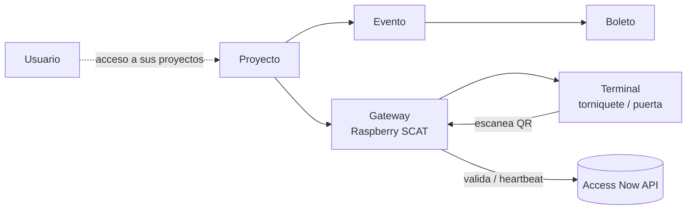

# Documentación de Access Now

Access Now administra eventos y boletos por proyecto, y los gateways (Raspberry con SCAT) que validan esos
boletos en los torniquetes. Esta carpeta explica cómo funciona.

## Por dónde empezar

| Documento | Para quién | Qué explica |
|---|---|---|
| [boletos.md](boletos.md) | Todos | Los tres estados de un boleto (venta, acceso, envío), el QR, la validación con y sin internet, el historial, el PDF y el correo. |
| [dispositivos.md](dispositivos.md) | Todos | Gateways y terminales: enrolamiento, conexión, configuración, cola de comandos y seguridad. |
| [contrato-api.md](contrato-api.md) | Desarrollo | Formato de respuestas y errores, validaciones y la tabla de endpoints. |
| [arquitectura.md](arquitectura.md) | Desarrollo | Capas del código y dónde va cada archivo. |
| [convencion-nombres.md](convencion-nombres.md) | Desarrollo | Código en inglés, contrato en español, nombres de carpetas. |
| [pruebas.md](pruebas.md) | Desarrollo | Qué pruebas escribir y cómo correrlas. |

## Cómo se relaciona todo

- **Usuarios y permisos:** cada usuario tiene un perfil de permisos (qué módulos ve: usuarios, proyectos,
  eventos, boletos, dispositivos...) y acceso a ciertos proyectos. Un super administrador ve todo. El permiso
  **"Ver historial"** no es una sección: decide quién ve el historial de boletos y dispositivos.
- **Proyecto:** el recinto o cliente. Sus eventos, boletos y dispositivos solo los ve quien tiene acceso a él.
- **Evento → boletos:** ver [boletos.md](boletos.md).
- **Gateway → terminales:** ver [dispositivos.md](dispositivos.md).

## Auditoría

Todo registro guarda **quién y cuándo lo creó** y **quién y cuándo lo modificó por última vez**; lo que hace
el sistema aparece como "Sistema" y lo que reporta un gateway, a su nombre. Además, boletos, dispositivos y
comandos tienen un **historial que no se puede editar ni borrar**.

## Glosario

| Término | Significado |
|---|---|
| **Heartbeat** | El "sigo vivo" que la Raspberry manda cada minuto; su respuesta trae los comandos pendientes. |
| **Token de enrolamiento** | Código de un solo uso para ligar una Raspberry a un gateway del dashboard. |
| **Token operativo** | Credencial que la Raspberry usa en cada llamada después de enrolarse. |
| **Huella** | Identificador del equipo (número de serie de la Raspberry) que acompaña al token. |
| **Comando** | Orden del dashboard para un gateway (configurar, retirar o sincronizar terminales). |
| **Catálogo** | Lista de boletos (por hash del QR) que la Raspberry guarda para validar sin internet. |
| **Hash del QR** | Huella del QR (SHA-256): sirve para validarlo, pero no para reconstruirlo. |
| **Folio** | Identificador legible del boleto (`AN-…`). No sirve para entrar: solo el QR. |
