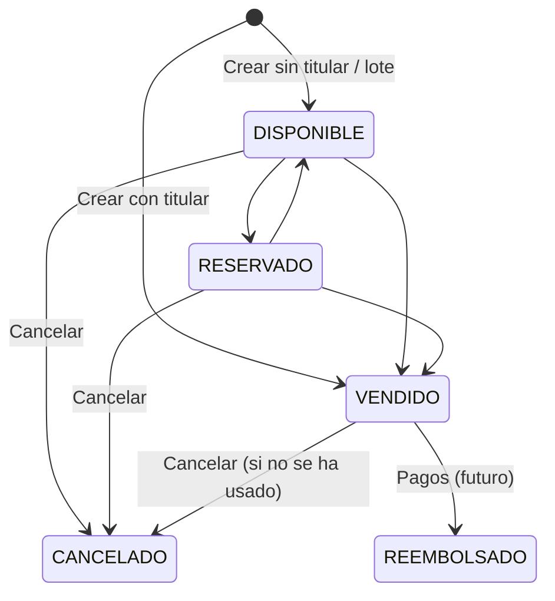

# Boletos: estados, QR, validación y envío

Cómo funciona un boleto en Access Now de principio a fin. Para el detalle de cada endpoint, ver
[contrato-api.md](contrato-api.md); para las capas del código, [arquitectura.md](arquitectura.md).

## Resumen

Un boleto pertenece a un **evento**, y el evento a un **proyecto**. Cada boleto tiene **tres estados
independientes**, que responden preguntas distintas:

| Estado | Pregunta que responde | ¿Se guarda? | Quién lo cambia |
|---|---|---|---|
| **Estado de venta** (`estadoVenta`) | ¿El boleto está vendido? | Sí | Un usuario del dashboard (y en el futuro, los pagos) |
| **Estado de acceso** (`estadoAcceso`) | ¿Este boleto deja entrar **ahora mismo**? | No: se calcula en cada consulta | Nadie lo cambia: depende de la venta, del uso, del evento y de la hora |
| **Estado de envío** (`estadoEnvio`) | ¿Ya se le mandó por correo? | Sí | El envío por correo |

Mantenerlos separados evita confusiones: **enviar un boleto no lo vende**, **venderlo no lo envía**,
y **que esté vendido no significa que hoy deje entrar** (el evento puede no haber empezado).

---

## 1. Estado de venta (`estadoVenta`)

El estado comercial del boleto.

| Valor | Significado |
|---|---|
| `DISPONIBLE` | Generado y sin vender. Su QR existe, pero **no deja entrar**. Es el estado de los boletos de un lote. |
| `RESERVADO` | Apartado para alguien, todavía sin vender. **No deja entrar.** |
| `VENDIDO` | Vendido o asignado a un titular. **Es el único que puede dejar entrar.** |
| `CANCELADO` | Anulado desde el dashboard: su QR se revoca y **libera capacidad** del evento. |
| `REEMBOLSADO` | Anulado por devolución. Reservado para la pasarela de pagos (#8); hoy ninguna acción lo asigna. |

### Cambios permitidos

Reglas (en `domain/policies/ticket/ticket-policy.ts`):

- **Un boleto vendido no vuelve a disponible.** Si hay que deshacer una venta, se **cancela**: así el
  historial dice la verdad y el QR viejo deja de servir.
- **Un boleto ya usado no se edita ni se cancela.** Esa persona ya entró: cancelarlo liberaría un lugar
  que sí se ocupó.
- **Un boleto anulado** (`CANCELADO` o `REEMBOLSADO`) **no se edita, no tiene QR, PDF ni envío.**
- Crear un boleto con datos del titular lo deja `VENDIDO`; sin titular, `DISPONIBLE`.
- **Capacidad:** si el evento tiene `capacidad`, los boletos `DISPONIBLE`, `RESERVADO` y `VENDIDO`
  cuentan contra ella (los anulados no). Se valida con el evento bloqueado, así que dos altas a la vez
  no se pasan del cupo.
- **Un evento inactivo no genera boletos.**

---

## 2. Estado de acceso (`estadoAcceso`)

Si el boleto **deja entrar en este momento**. **No se guarda**: se calcula cada vez a partir del estado
de venta, de si ya se usó, de si el evento está activo y de la hora en la zona horaria del evento. Así
nunca queda "viejo" (por ejemplo, un boleto no pasa a "no utilizado" por un proceso nocturno: lo es en
cuanto termina el evento).

Se evalúa **en este orden** (la primera regla que aplica gana):

| Orden | Valor | Cuándo | Mensaje en la terminal |
|---|---|---|---|
| 1 | `ANULADO` | Venta `CANCELADO` o `REEMBOLSADO` | "El boleto fue cancelado" |
| 2 | `USADO` | Ya entró (`usadoEn` tiene fecha) | "El boleto ya fue utilizado" |
| 3 | `EVENTO_INACTIVO` | El evento está desactivado | "El evento está inactivo" |
| 4 | `NO_VENDIDO` | Venta `DISPONIBLE` o `RESERVADO` | "El boleto no está vendido" |
| 5 | `NO_VIGENTE` | Todavía no llega la hora de inicio | "El evento todavía no empieza" |
| 6 | `VIGENTE` | Entre el inicio y el fin | (deja entrar: "Acceso concedido") |
| 7 | `NO_UTILIZADO` | Ya pasó la hora de fin y nunca entró | "El evento ya terminó" |

**Solo `VIGENTE` deja entrar.** La hora de fin cuenta completa: un evento que termina a las 23:00 deja
entrar hasta las 23:00:59.

---

## 3. Estado de envío (`estadoEnvio`)

Si el boleto ya se mandó por correo.

| Valor | Significado |
|---|---|
| `NO_ENVIADO` | Nunca se ha enviado. |
| `ENVIADO` | Se envió al menos una vez. El boleto guarda `enviadoEn` (cuándo) y `enviadoA` (a qué correo). |
| `ERROR` | Se intentó y falló, y nunca se había enviado antes. |

- Un **reenvío que falla no borra** un `ENVIADO` anterior: el boleto sí llegó antes.
- **Cada intento** (exitoso o no) queda en la tabla `boleto_envios` con el correo, el resultado y quién
  lo mandó, y en el historial del boleto (`ENVIADO` o `ENVIO_FALLIDO`).
- **Solo se envían boletos vendidos.**
- **A qué correo:** al que se escriba al enviar o, si no se escribe, al del titular. Si el boleto no
  tenía correo, el que se use queda guardado como el del titular. Si ya tenía uno, mandarlo a otro **no**
  cambia el del titular.

---

## 4. El código QR

- Es un **token aleatorio** con el formato `AN1.<43 caracteres>`: no contiene datos del boleto ni se
  puede adivinar.
- La base de datos lo guarda **dos veces y nunca en claro**:
  - su **SHA-256**, para validar escaneos (con el hash no se puede reconstruir el QR);
  - **cifrado con AES-256-GCM**, para poder mostrarlo otra vez (Ver QR, PDF, correo). La clave es
    `TICKET_QR_ENCRYPTION_KEY`, distinta de la de sesiones y obligatoria en producción.
- **Los listados nunca incluyen el QR.** Solo aparece al crear el boleto, en "Ver QR", en el PDF y en
  el correo. **Cada vez que alguien lo ve queda en el historial** (`QR_CONSULTADO`).
- **Reemitir el QR** revoca el anterior al instante y genera uno nuevo. Sirve si el QR se filtró o se
  compartió. No se puede reemitir un boleto usado o anulado.

---

## 5. Validación en la entrada

La hace la Raspberry (SCAT) a la que están conectados los torniquetes. Ver también
[dispositivos.md](dispositivos.md).

### Con internet

La terminal lee el QR y SCAT lo manda a Access Now (`POST /api/v1/tickets/validate`) junto con la MAC
de la terminal:

1. Si el QR no tiene el formato de Access Now → **RECHAZADO** "QR no reconocido".
2. Si no existe en el proyecto del gateway (o fue revocado) → **RECHAZADO** "Boleto no encontrado o cancelado".
3. Si su estado de acceso no es `VIGENTE` → **RECHAZADO** con el mensaje de la tabla de arriba.
4. Si es `VIGENTE` → **CONCEDIDO** y se marca **usado** en ese mismo momento.

El paso 4 es **atómico**: si dos torniquetes leen el mismo QR al mismo tiempo, solo uno deja pasar. La
respuesta siempre es la misma forma (`acceso`, `message`, `boleto`), y a la terminal **nunca** le llega el
correo ni el teléfono del titular.

### Sin internet

Si Access Now no responde a tiempo, SCAT decide con su **catálogo local**:

- Cada minuto descarga los boletos vendidos de los eventos activos que están en curso o empiezan en
  menos de 24 h (la primera vez completo, después solo los cambios). **Solo trae el hash de cada QR.**
- Sin red, revisa el horario del evento y que el boleto no se haya usado, lo marca usado en esa Raspberry
  y deja pasar: "Acceso concedido (sin conexion)".
- Al volver la red, sube esos pases y Access Now los registra con la **hora real** del escaneo:

| Resultado | Qué pasó |
|---|---|
| `ACEPTADO` | El boleto era válido: queda usado. |
| `DUPLICADO` | Ese boleto ya había entrado por otra puerta: queda **observado** en el historial. |
| `NO_VALIDO` | Lo habían cancelado (o reemitido su QR) mientras no había red: queda **observado**. |
| `DESCONOCIDO` | El QR no existe en el proyecto. |

> Limitación aceptada: con varias puertas sin internet a la vez, un mismo boleto podría pasar por más de
> una antes de sincronizar. Access Now lo detecta al subir los pases y lo deja marcado como `DUPLICADO`.

---

## 6. Historial del boleto

Cada boleto tiene un historial **que no se puede editar ni borrar**: solo se agregan entradas, con quién
y cuándo. Lo que hace un gateway aparece a su nombre (por ejemplo "Gateway Puerta 1"); lo automático,
como "Sistema".

| Tipo | Cuándo |
|---|---|
| `GENERADO` | Se creó sin titular (suelto o en lote). |
| `VENDIDO` | Se creó con titular, o pasó a vendido. |
| `RESERVADO` | Pasó a reservado. |
| `ASIGNADO` | Se cambió su estado de venta sin tocar al titular (incluye liberar un reservado). |
| `REASIGNADO` | Se cambiaron los datos del titular. |
| `CANCELADO` | Se canceló. |
| `QR_CONSULTADO` | Alguien vio el QR (Ver QR, PDF). |
| `QR_REEMITIDO` | Se reemitió el QR. |
| `ACCESO_CONCEDIDO` | Entró. En `detalle`: gateway, terminal (MAC) y, si fue sin red, `offline` y `escaneadoEn`. |
| `ACCESO_RECHAZADO` | Se intentó usar y no pasó, con el motivo. |
| `ENVIADO` / `ENVIO_FALLIDO` | Intento de envío por correo, con el correo usado. |

`VALIDADO` y `REEMBOLSADO` existen en el catálogo de tipos pero todavía no se usan.

---

## 7. PDF y correo

- **El PDF lo genera la API** (`GET /boletos/:id/pdf`), siempre igual para la vista previa, la descarga
  y el correo. Es un boleto electrónico en hoja carta: talón con el QR (unos 4.6 cm, legible por los
  torniquetes), folio, titular, correo y fecha de emisión; cuerpo con evento, horario, lugar con enlace
  al mapa y organizador; y las condiciones de uso abajo.
- Varios boletos en un solo PDF, uno por página (hasta 200): útil para imprimir un lote.
- **El correo** lleva el PDF adjunto y un resumen (evento, horario, lugar, folio). El QR viaja solo dentro
  del PDF.
- Abrir el PDF cuenta como ver el QR (`QR_CONSULTADO`).

---

## 8. Eventos

- Un evento tiene fecha y hora de inicio y fin **en su zona horaria** (por defecto
  `America/Mexico_City`), capacidad opcional y un estado activo/inactivo.
- **Desactivar un evento** detiene todo: nadie entra (`EVENTO_INACTIVO`) y no se generan boletos.
- **Un evento con boletos no se puede borrar** (ni desde la API ni directo en la base): se desactiva.
  Así nunca se pierden sus boletos ni su historial.

---

## 9. Ciclo de vida de ejemplo

1. Se crea el evento "Final" con capacidad 5,000.
2. Se genera un **lote** de 1,000 boletos → `DISPONIBLE`, acceso `NO_VENDIDO`, envío `NO_ENVIADO`.
3. Se vende uno: se capturan los datos del titular → `VENDIDO`.
4. Se envía por correo → envío `ENVIADO`.
5. Antes del evento: acceso `NO_VIGENTE` ("El evento todavía no empieza").
6. Durante el evento: acceso `VIGENTE`. La persona escanea su QR → **CONCEDIDO** → acceso `USADO`.
7. Alguien intenta entrar con una copia del mismo QR → **RECHAZADO** "El boleto ya fue utilizado".
8. Otro boleto vendido nunca se usó: al terminar el evento, su acceso pasa a `NO_UTILIZADO`.

---

## Pendientes conocidos

- **Tipos de boleto** (zona, fila, asiento, precio) y **órdenes de compra**: parte de #3 y de la pasarela de
  pagos (#8). El PDF ya tiene espacio para mostrarlos.
- `REEMBOLSADO` se asignará con los pagos (#8).
- Liberar un boleto reservado se registra como `ASIGNADO`; convendría un tipo propio (`LIBERADO`).
