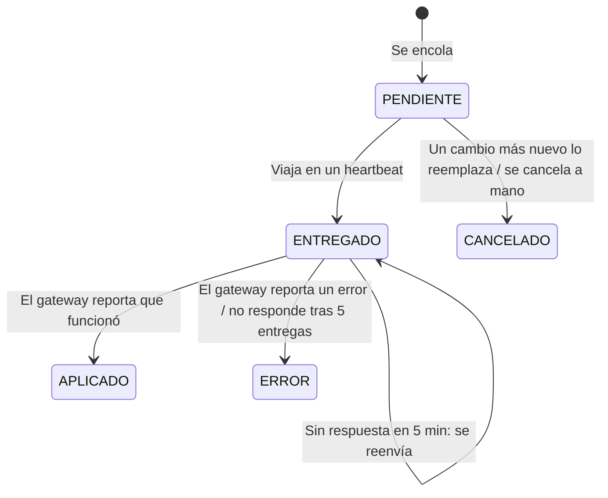

# Dispositivos: gateways, terminales y sus estados

Cómo Access Now administra las Raspberry (gateways) y los torniquetes o puertas (terminales) de cada
proyecto. Para los endpoints, ver [contrato-api.md](contrato-api.md); para la parte de la Raspberry,
`docs/access-now.md` del repositorio SCAT-API.

## Las piezas

| Pieza | Qué es | Ejemplo |
|---|---|---|
| **Proyecto** | El recinto o cliente. Todo pertenece a uno. | Estadio Norte |
| **Gateway** | Una Raspberry con SCAT en la red del recinto. Valida boletos y configura terminales. Puede haber varios por proyecto. | Raspberry de la puerta 1 |
| **Terminal** | Un torniquete o puerta Hikvision. Siempre cuelga de un gateway y se identifica por su **MAC**. | Torniquete 3, carril 2, entrada |

**La Raspberry siempre inicia la conexión.** Access Now nunca la llama: no hay que abrir puertos ni tener
IP pública en el recinto. Todo viaja en el **heartbeat** (cada 60 s) y su respuesta.

---

## 1. Enrolamiento: cómo se liga una Raspberry

1. En el dashboard se crea el gateway y se genera un **token de enrolamiento**: de un solo uso, vence en
   1, 24 o 168 horas, y el enrolamiento dura 30, 90 días o sin vencimiento.
2. En la Raspberry: `scat accessnow enlazar https://<servidor> <token>`.
3. Access Now le entrega su **token operativo** (la API solo guarda su hash) y le dice a qué proyecto y
   gateway pertenece. Desde ese momento manda heartbeats.

El enrolamiento queda ligado a la **huella del equipo**, que sale del número de serie de la Raspberry.
Una copia del token o de la SD en otra placa es rechazada.

### Estados del enrolamiento

| Estado | Significado | Cómo se llega |
|---|---|---|
| Sin enrolar | Nunca se ha ligado, o se revocó. | Estado inicial / "Revocar" |
| Activo | Ligado y vigente. | Enrolar con un token |
| Vence pronto | Le quedan menos de 7 días. | El tiempo |
| Vencido | Pasó su fecha: la Raspberry recibe `401` y pide volver a enlazar. | El tiempo |

**Revocar** (botón en el estado del gateway) corta el acceso al instante sin borrar ni desactivar el
gateway: hay que volver a enrolarlo con un token nuevo.

---

## 2. Conexión de un gateway

| Estado | Significado |
|---|---|
| **Sin enrolar** | No tiene enrolamiento: no puede conectarse. |
| **En línea** | Su último heartbeat llegó hace menos de **3 minutos** (3 heartbeats perdidos). |
| **Fuera de línea** | Enrolado, pero lleva más de 3 minutos sin heartbeat. |

Un proceso revisa cada 30 s quién dejó de reportar, lo marca fuera de línea y lo anota en el historial.
Un gateway **sin enrolamiento nunca aparece en línea**, aunque haya reportado hace poco.

## 3. Conexión de una terminal

| Estado | Significado |
|---|---|
| **Sin reporte** | Su gateway nunca la ha reportado. |
| **En línea** | Su gateway está en línea **y** la reporta conectada. |
| **Fuera de línea** | La reporta desconectada, o su gateway dejó de reportar. |

El gateway manda la lista de sus terminales **solo cuando cambia**: alta, baja, cambio de IP o de
conexión. Access Now la toma como la verdad física:

- **MAC conocida:** actualiza su IP (aunque el router le haya dado otra), modelo, conexión y gateway.
- **MAC nueva:** la registra sola como terminal **Configurada**, con el evento "Detectada por el gateway".
- **Terminales que faltan en la lista:** pasan a fuera de línea.

## 4. Configuración de una terminal (`configEstado`)

Si la terminal ya quedó configurada en su gateway con lo que dice el dashboard.

| Valor | Significado |
|---|---|
| `PENDIENTE` | Hay un cambio esperando a que el gateway lo aplique. |
| `CONFIGURADA` | El gateway confirmó que la configuró. |
| `ERROR` | El gateway no pudo (con el detalle, por ejemplo "No se pudo leer la terminal en 192.168.1.50"), o el comando se canceló. |
| `RETIRADA` | Se desactivó o borró, y el gateway confirmó que la retiró. |

---

## 5. Cola de comandos

Como la API no puede llamar a la Raspberry, los cambios del dashboard se convierten en **comandos** que
esperan en una cola y viajan en la respuesta del siguiente heartbeat (máximo un minuto de espera).

| Cambio en el dashboard | Comando |
|---|---|
| Alta de una terminal activa, cambio de IP, carril o sentido, reactivarla | `CONFIGURAR_TERMINAL` |
| Desactivar o borrar una terminal | `ELIMINAR_TERMINAL` |
| Moverla a otro gateway o cambiarle la MAC | `ELIMINAR_TERMINAL` en el anterior + `CONFIGURAR_TERMINAL` |
| Botón "Sincronizar terminales", o enrolar/re-enrolar el gateway | `SINCRONIZAR` (todas las terminales activas) |
| Botón "Reaplicar configuración" de una terminal | `CONFIGURAR_TERMINAL` |
| Renombrarla | Nada (la Raspberry no usa el nombre) |

### Estados de un comando

- **Solo viaja el estado más reciente:** si una terminal se edita dos veces antes del heartbeat, el
  primer comando se cancela ("reemplazado por un cambio más reciente").
- **Sin respuesta**, un comando entregado se reenvía a los 5 minutos; tras 5 entregas queda en `ERROR`.
  La Raspberry los trata como idempotentes: recibir uno dos veces no hace daño.
- Solo se puede **cancelar** un comando `PENDIENTE` (uno entregado puede estar ejecutándose).
- Cada comando guarda quién lo pidió, cuándo y quién reportó el resultado.

---

## 6. Seguridad del acceso de los gateways

- **Solo https** en producción.
- **Token + huella en cada llamada:** sin la huella del enrolamiento, `401`. Si la huella no coincide,
  además queda una **alerta de seguridad** en el historial del gateway ("se usó su token desde otro equipo").
- **Uso simultáneo:** si el gateway reporta desde otra red mientras seguía en línea, también queda una
  alerta. Máximo una alerta cada 10 minutos.
- **Intentos fallidos limitados por IP** (15 min): 10 en el enrolamiento y 20 con token; después `429`.

## 7. Historial del gateway y de la terminal

Solo se agregan entradas, con quién y cuándo:

| Tipo | Cuándo |
|---|---|
| `TOKEN_GENERADO` | Se generó un token de enrolamiento. |
| `ENROLADO` / `REENROLADO` | La Raspberry se enlazó (por primera vez / de nuevo). |
| `CONECTADO` / `DESCONECTADO` | Volvió a reportar / dejó de reportar más de 3 minutos. |
| `REVOCADO` | Se revocó el enrolamiento. |
| `ALERTA_SEGURIDAD` | Huella distinta o uso desde dos redes a la vez. |
| `TERMINAL_DETECTADA` | (En la terminal) el gateway la registró o la reasignó por su MAC. |

`ENROLAMIENTO_VENCIDO` y `ERROR` existen en el catálogo de tipos pero todavía no se usan.

---

## 8. Configuración del servidor

| Variable | Por defecto | Para qué |
|---|---|---|
| `DEVICE_HEARTBEAT_INTERVAL_MS` | 60000 | Cada cuánto reporta la Raspberry (se le indica en cada respuesta). |
| `DEVICE_OFFLINE_AFTER_MS` | 180000 | Sin heartbeat por este tiempo, fuera de línea. |
| `DEVICE_PRESENCE_CHECK_MS` | 30000 | Cada cuánto se revisa quién dejó de reportar. |
| `DEVICE_COMMAND_RETRY_MS` | 300000 | Reenvío de un comando entregado sin respuesta. |
| `DEVICE_COMMAND_MAX_ATTEMPTS` | 5 | Entregas antes de marcar el comando en `ERROR`. |
